# Design

One calm look for a notebook: system fonts, one accent, no decoration.
The screens and rules of use are in [behaviour](behaviour.md). Same
design language as the sister app Mixtura (token names, 44 px targets,
the focus ring, light and dark blocks)[^mixtura]; the accent differs.

Implemented in `packages/app/src/styles/`: `tokens.css` holds every
colour, font size, spacing and radius; `base.css`, `shell.css` and
`screens.css` use `var(--...)` only. **Test:**
`test/tokens-only.test.ts` fails when another stylesheet has a hex, `rgb`,
`hsl` or other colour function, a `font-size` that is not a `--fs-*` token
(or `inherit`, or `100%` on `html`), a `font:` shorthand, a web font or
a URL.

# Themes

Three choices on the Settings screen, a radio group: **Follow system**
(default), **Light**, **Dark**. The choice is kept in `localStorage`
under `culina.theme`. It sets `data-theme` on `<html>`; Follow system
removes the attribute. `tokens.css` has the light set on `:root`, the
dark set under `@media (prefers-color-scheme: dark)` guarded by
`:root:not([data-theme='light'])`, and the same dark set under
`:root[data-theme='dark']`. The small script `theme-init.js` is loaded
before the stylesheet and sets the attribute before the first paint, so
there is no flash; it is a file, not inline, because the Content Security
Policy allows no inline script. **Tests:** `test/prefs.test.ts`
(storage missing or throwing, unknown value), `test/contrast.test.ts`
(both dark blocks identical, same tokens in both themes),
`e2e/smoke.mjs` (switching, reload, Follow system with a dark system,
Light over a dark system).

# Colour

| Token           | Light     | Dark      | Use                                      |
| --------------- | --------- | --------- | ---------------------------------------- |
| `--bg`          | `#FAF9F6` | `#151311` | Page background                          |
| `--surface`     | `#FFFFFF` | `#1F1C19` | Header, navigation, groups               |
| `--surface-2`   | `#F1EEE8` | `#2A2623` | Group headings                           |
| `--text`        | `#1D1A17` | `#F3EFEA` | Text                                     |
| `--text-muted`  | `#5A544D` | `#B7AFA6` | Secondary text, navigation labels        |
| `--border`      | `#857E75` | `#8A8279` | Outlines of controls and bars (3:1)      |
| `--divider`     | `#E3DED5` | `#38332E` | Hairlines (decorative, not relied on)    |
| `--accent`      | `#A02B45` | `#F29BAF` | Current destination, links, radio, marks |
| `--on-accent`   | `#FFFFFF` | `#2A0A12` | Text on `--accent`                       |
| `--accent-soft` | `#F9E3E8` | `#3C1A24` | Current destination background           |
| `--focus`       | `#1D1A17` | `#F3EFEA` | Focus ring                               |

## Accent: Beet

A deep beetroot red (`#A02B45`, `#F29BAF` in dark). Mixtura's accent is
copper, hue about 25 degrees; Beet sits near 346 degrees, so the two apps
differ at a glance while both stay warm. It is dark enough for 4.5:1 text
on the paper-coloured background, and the pale dark-mode variant keeps
that. It is a proposal in the same sense as Mixtura's: the owner decides.
Changing it means changing `--accent`, `--on-accent` and `--accent-soft`
in the three blocks of `tokens.css` and the two `theme-color` metas,
`manifest.webmanifest` and the SVG icons (the build does not copy the
accent to them; `test/manifest.test.ts` checks the metas and the
manifest against `--bg`).

## Contrast

WCAG relative luminance, computed from the hex values of `tokens.css` by
`test/contrast.test.ts` (sRGB, no alpha)[^wcag]. Text needs 4.5:1, parts
of the interface and the focus ring 3:1. The test fails when a pair falls
below its minimum in either theme, and when a row below no longer matches
the computed value.

| Pair                              | Light | Dark  | Needed |
| --------------------------------- | ----- | ----- | ------ |
| `--text` on `--bg`                | 16.45 | 16.19 | 4.5    |
| `--text` on `--surface`           | 17.32 | 14.81 | 4.5    |
| `--text` on `--surface-2`         | 14.96 | 13.10 | 4.5    |
| `--text` on `--accent-soft`       | 14.17 | 13.44 | 4.5    |
| `--text-muted` on `--bg`          | 7.10  | 8.56  | 4.5    |
| `--text-muted` on `--surface`     | 7.47  | 7.83  | 4.5    |
| `--text-muted` on `--surface-2`   | 6.45  | 6.93  | 4.5    |
| `--text-muted` on `--accent-soft` | 6.11  | 7.10  | 4.5    |
| `--accent` on `--bg`              | 6.82  | 8.90  | 4.5    |
| `--accent` on `--surface`         | 7.18  | 8.14  | 4.5    |
| `--accent` on `--accent-soft`     | 5.87  | 7.38  | 4.5    |
| `--on-accent` on `--accent`       | 7.18  | 8.76  | 4.5    |
| `--border` on `--bg`              | 3.81  | 4.90  | 3      |
| `--border` on `--surface`         | 4.01  | 4.48  | 3      |
| `--focus` on `--bg`               | 16.45 | 16.19 | 3      |
| `--focus` on `--surface`          | 17.32 | 14.81 | 3      |
| `--focus` on `--accent-soft`      | 14.17 | 13.44 | 3      |

All pairs pass in both themes. The weakest are `--border` on `--surface`
in dark (4.48) and `--text-muted` on `--accent-soft` in light (6.11).
The rendered colours in the browser are not measured; the e2e run checks
the tokens through the page (background changes with the theme), not
each text node.

# Type, spacing, radius

System font stack `system-ui, -apple-system, 'Segoe UI', Roboto,
'Helvetica Neue', Arial, sans-serif`; no web font, nothing loaded.

| Token     | Size             | Use                                 |
| --------- | ---------------- | ----------------------------------- |
| `--fs-xs` | 0.75rem (12 px)  | Navigation labels on the phone      |
| `--fs-sm` | 0.875rem (14 px) | Secondary text                      |
| `--fs-md` | 1rem (16 px)     | Body, side navigation, app name     |
| `--fs-lg` | 1.25rem (20 px)  | Screen headings                     |
| `--fs-xl` | 1.5rem (24 px)   | Reserved for a large empty headline |

Sizes are in `rem`, so the system's text size setting scales them.
Weights: 400 body, 600 labels and summaries, 700 headings and the current
destination. Spacing `--sp-1` 4, `--sp-2` 8, `--sp-3` 12, `--sp-4` 16,
`--sp-5` 24, `--sp-6` 32 px; radius `--radius` 12 px, `--radius-sm` 8 px;
`--target` 44 px; `--dim` 0.6 (opacity of results shown again while an entry is not a number); `--nav-h` 64 px; `--side-w` 220 px; `--content-w`
720 px; focus ring `--focus-width` 3 px with `--focus-offset` 2 px.

# Layout and breakpoints

- **360 x 720 first.** Designed at 360 px, 320 px must not break; no
  horizontal scroll at 320, 360 or 1000 px. **Test:** `e2e/smoke.mjs`
  (every screen at 320, 360 and 1000 px).
- **One breakpoint at 720 px** (`@media (min-width: 720px)` in
  `shell.css`; media queries cannot read custom properties). Below it:
  header, one pane, **bottom navigation** (icon above label, sticky, 64 px
  high). From 720 px: **side navigation** (`--side-w` wide, icon beside
  label) with the app name above it, content on the right at most
  `--content-w` wide. **Test:** `e2e/smoke.mjs` (bottom bar at 360 px, side
  column at 1000 px).
- **Touch targets at least 44 x 44 px**: navigation links, summaries and
  radio rows. **Test:** `e2e/smoke.mjs` measures them on every screen.
- **Visible focus.** Every focusable element shows a `--focus-width`
  outline in `--focus`; navigation links draw it inside their box so the
  bar does not clip it. Never removed except on `<main>`, which is
  focused only by the skip link. **Test:** `e2e/smoke.mjs` (ring on the
  first navigation link).
- **The current destination is not shown by colour alone:** accent
  colour, bold text and a 4 px bar on the top (phone) or left (desktop)
  edge, plus `aria-current="page"`.
- **Motion.** None needed; under `prefers-reduced-motion: reduce`
  transitions and animations are off (`base.css`).
- **No hover-only affordance:** nothing appears or changes meaning on
  hover; there are no hover styles.

# Ratio screens

Rows and tables follow the tokens above. Ratio rows are `--surface` boxes
with a `--divider` hairline, the open card marked by `--accent-soft` and a
bar like the navigation. Tables have right-aligned numbers with tabular
figures (class `num`). Nothing on these screens uses an alarm colour: an
entry that is not a number gets a dashed outline and a text hint, the
range display is plain text, and dimmed results use `--dim`. From 720 px
the list (16 rem) sits beside the card; below it the card is a screen of
its own. Rules of use: [behaviour](behaviour.md#ratios).

# Component and dish screens

Shared pieces (panes, fields, list rows, cards, tables, `num`) live in
`common.css`; `notebook.css` adds the line, slot and raw tables (fixed
layout, number columns of 5 to 6 rem), the small "component" tag (an outline,
no fill), the yield figures, the 44 px portion buttons and the open slot: a
dashed `--border` outline with `--text-muted` text. There is no error or
warning token, and none was added. Rules of use:
[behaviour](behaviour.md#components).

# Editor screens

Buttons (`.btn`, `.primary`, `.quiet`, in `editor.css`) are 44 px high with
the existing tokens: the primary one is `--accent` on `--on-accent`, the
others `--surface` with a `--border` outline. A line or slot of the editor is
a bordered card of the list-row family; the picker opens inside it. Percent
lines show their unit as a fixed muted "%", with the grams they come to in
`--text-muted` below. A value that cannot be stored gets the dashed outline
of the number fields and a quiet sentence next to Save, never an alarm
colour. The toast is a bordered `--surface` box with the accent bar, above the
bottom navigation on a phone and in the corner from 720 px. No new token.
Rules of use: [behaviour](behaviour.md#editor).

# Icons

Own simple line icons drawn for this app, AGPL-3.0-or-later like the
repository; no icon set is used. Rules: 24 x 24 px grid, 2 px stroke,
round caps and joins, `currentColor` (so they follow the theme), no fill,
`aria-hidden="true"` and `focusable="false"` because the label is visible
beside them. An icon-only button, when one is added, gets an `aria-label`
(`e2e/smoke.mjs` fails on any link, button, input or summary without a
name). Navigation icons are in `src/icons/icons.ts`: Ratios (a ratio
sign), Components (three layers), Dishes (a plate), Settings (two
sliders). App icons are in `src/assets/`: `icon.svg` (rounded square,
Beet with a notebook and a bookmark), `icon-maskable.svg` (full bleed,
content inside the central 80 % safe zone); the PNGs (192, 512 and
maskable 512) are made by `scripts/make-icons.mjs` with Playwright's
Chromium and committed.

# Copy

Short texts for an experienced cook: no tutorials, no exclamation marks,
at most 120 characters. Guidance, where there is any, sits in a
collapsible `
`. All visible texts are in `src/strings.ts`.
**Test:** `test/strings.test.ts`.

# Screenshots

Made by `npm run screenshots -w @culina/app` (Chromium, scale 2).

| Screen                       | Image                                                                         |
| ---------------------------- | ----------------------------------------------------------------------------- |
| Ratios, 360 x 720 light      |                         |
| Ratios, 360 x 720 dark       | 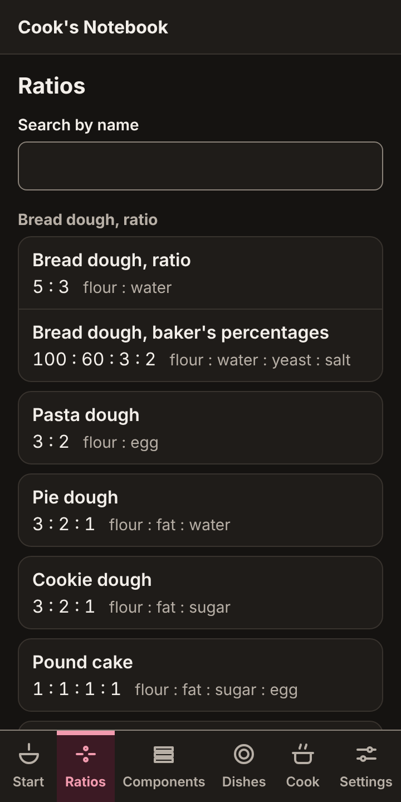                          |
| Settings, 360 x 720          |                            |
| Ratios, 1000 x 700           |                      |
| Ratio list, 360 x 720        | 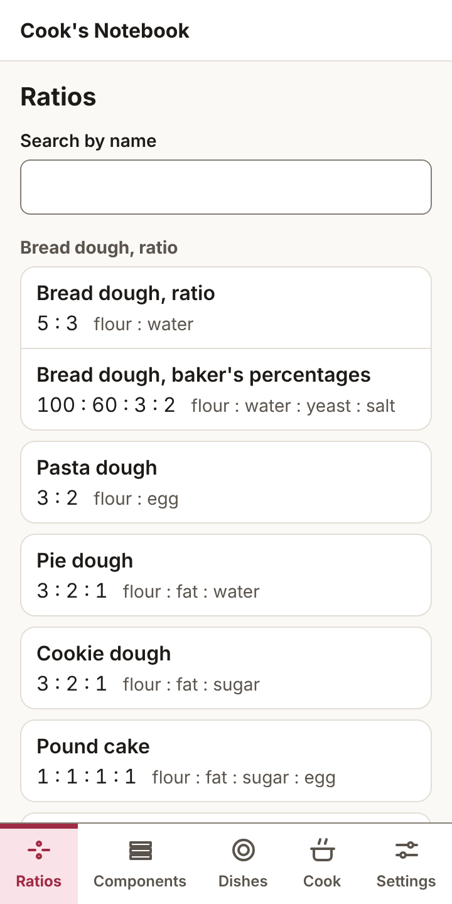                       |
| Ratio card, 360 light        | 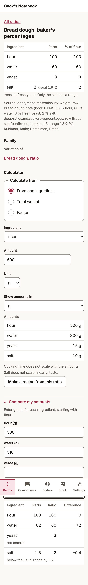                |
| Ratio card, 360 dark         |                   |
| Ratio card, 1000 x 700       |              |
| Component, 360 x 720         | 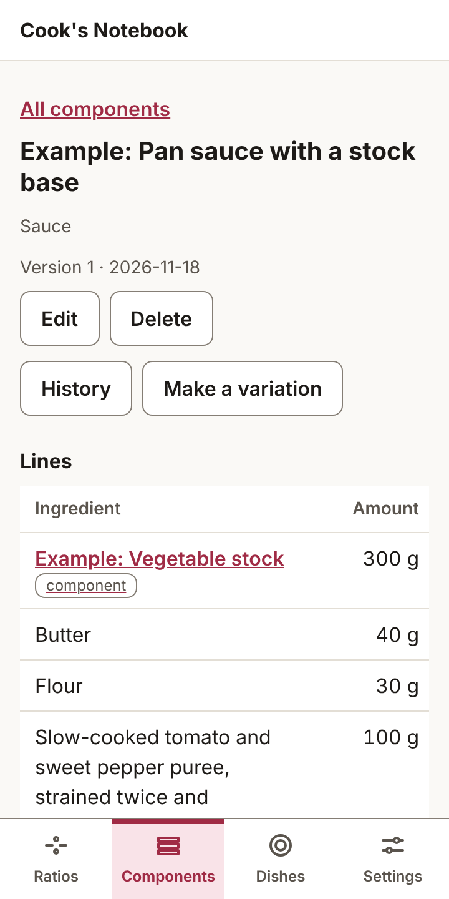                         |
| Dish, 360 x 720 light        | 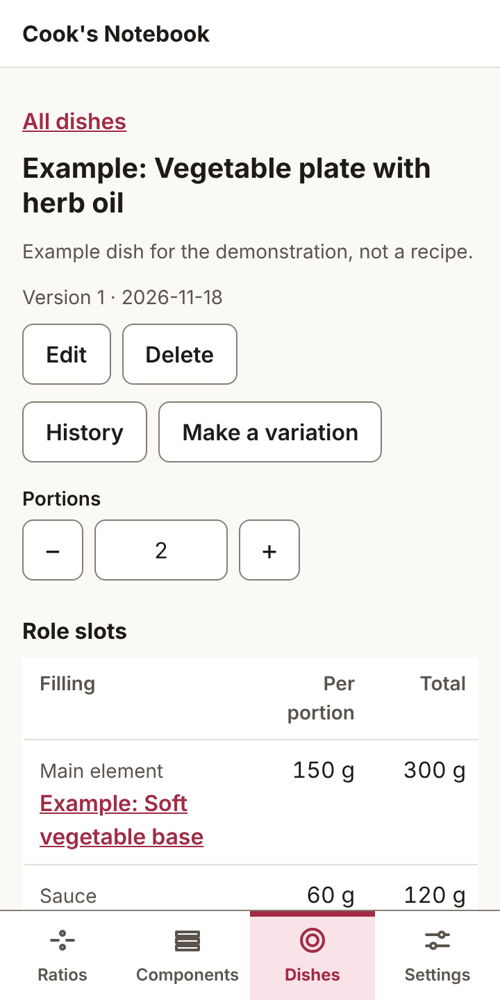                            |
| Dish, 360 x 720 dark         | 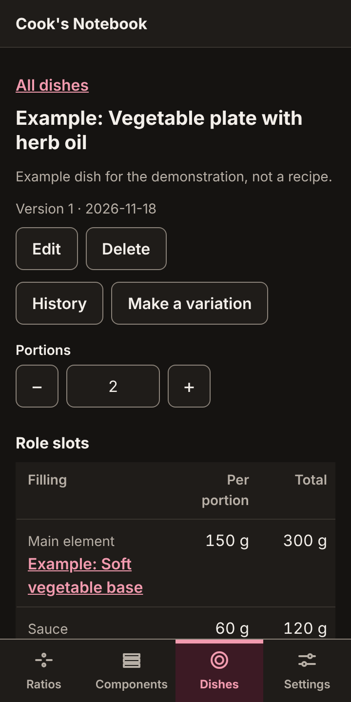                              |
| Dish, 1000 x 700             | 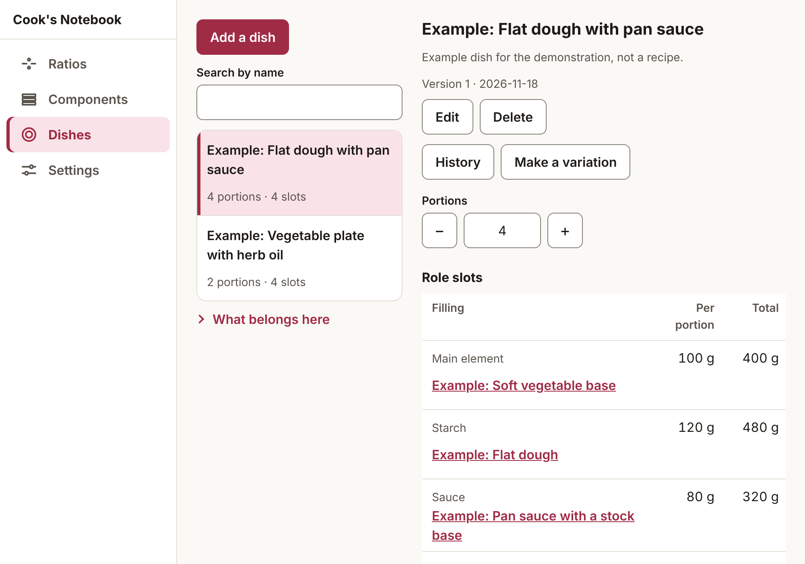                         |
| Component editor, 360 light  |     |
| Component editor, 360 dark   | 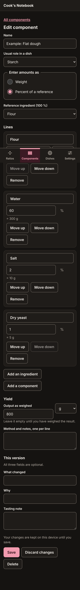      |
| Component editor, 1000 x 700 |  |
| Ingredient picker, 360 x 720 |                         |
| Dish editor, 360 x 720       | 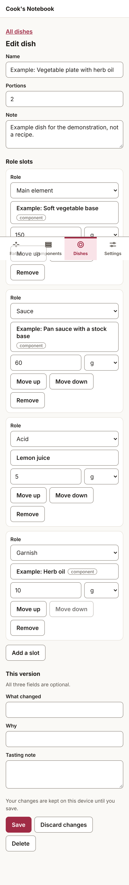                     |
| Dish editor, 1000 x 700      |            |
| History, 360 x 720 light     | 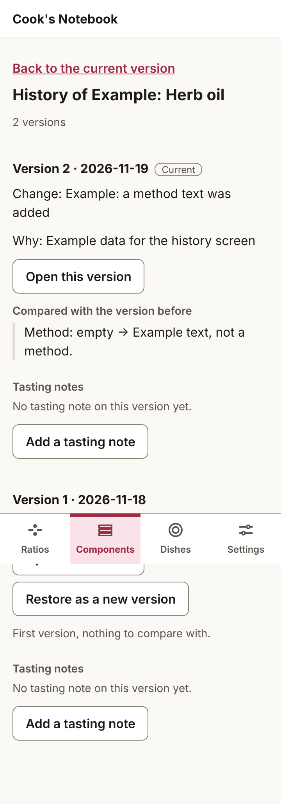                      |
| History, 360 x 720 dark      |                         |
| History, 1000 x 700          | 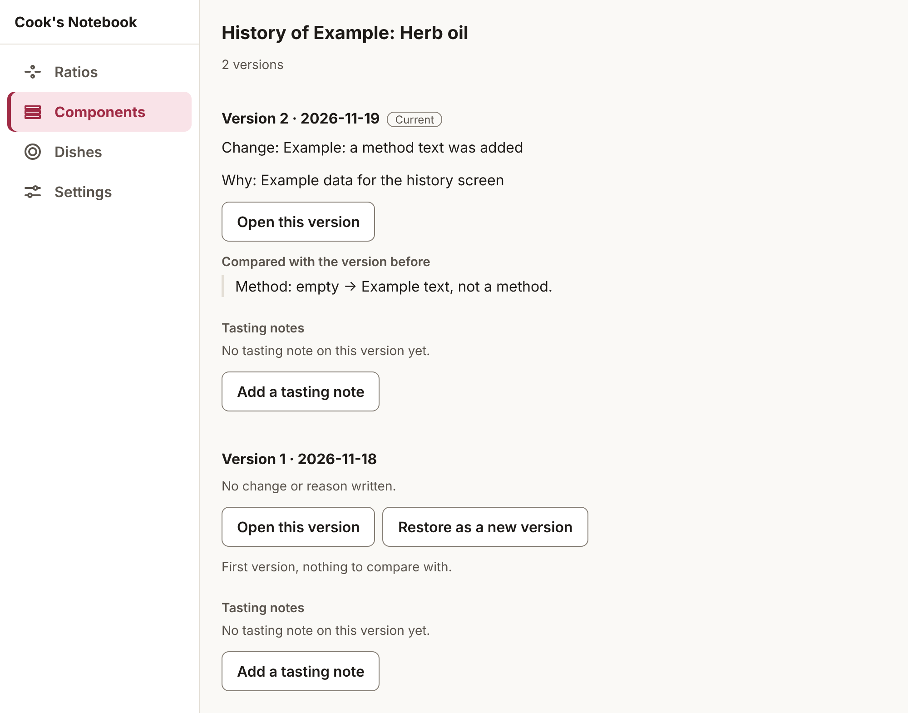                   |
| Older version, 360 x 720     |                    |
| Older version, 1000 x 700    |          |

[^wcag]: W3C, WCAG 2.2, <https://www.w3.org/TR/WCAG22/>, read 2026-11-18.

[^mixtura]: Mixtura, `docs/design.md`, <https://github.com/nexumia-de/mixtura>, read 2026-11-18; no source code was read or copied.
