# Design

One calm look for a notebook: system fonts, one accent, no decoration.
The screens and rules of use are in [behaviour](behaviour.md). Same
design language as the sister app Mixtura (token names, 44 px targets,
the focus ring, light and dark blocks)[^mixtura]; the accent differs.

Implemented in `packages/app/src/styles/`: `tokens.css` holds every
colour, font size, spacing and radius; `base.css`, `shell.css` and
`screens.css` use `var(--...)` only. **Test:**
`test/tokens-only.test.ts` fails when another stylesheet has a hex, `rgb`,
`hsl` or other colour function, a `font-size` that is not a `--fs-*` token
(or `inherit`, or `100%` on `html`), a `font:` shorthand, a web font or
a URL.

# Themes

Three choices on the Settings screen, a radio group: **Follow system**
(default), **Light**, **Dark**. The choice is kept in `localStorage`
under `culina.theme`. It sets `data-theme` on `<html>`; Follow system
removes the attribute. `tokens.css` has the light set on `:root`, the
dark set under `@media (prefers-color-scheme: dark)` guarded by
`:root:not([data-theme='light'])`, and the same dark set under
`:root[data-theme='dark']`. The small script `theme-init.js` is loaded
before the stylesheet and sets the attribute before the first paint, so
there is no flash; it is a file, not inline, because the Content Security
Policy allows no inline script. **Tests:** `test/prefs.test.ts`
(storage missing or throwing, unknown value), `test/contrast.test.ts`
(both dark blocks identical, same tokens in both themes),
`e2e/smoke.mjs` (switching, reload, Follow system with a dark system,
Light over a dark system).

# Colour

| Token           | Light     | Dark      | Use                                      |
| --------------- | --------- | --------- | ---------------------------------------- |
| `--bg`          | `#FAF9F6` | `#151311` | Page background                          |
| `--surface`     | `#FFFFFF` | `#1F1C19` | Header, navigation, groups               |
| `--surface-2`   | `#F1EEE8` | `#2A2623` | Group headings                           |
| `--text`        | `#1D1A17` | `#F3EFEA` | Text                                     |
| `--text-muted`  | `#5A544D` | `#B7AFA6` | Secondary text, navigation labels        |
| `--border`      | `#857E75` | `#8A8279` | Outlines of controls and bars (3:1)      |
| `--divider`     | `#E3DED5` | `#38332E` | Hairlines (decorative, not relied on)    |
| `--accent`      | `#A02B45` | `#F29BAF` | Current destination, links, radio, marks |
| `--on-accent`   | `#FFFFFF` | `#2A0A12` | Text on `--accent`                       |
| `--accent-soft` | `#F9E3E8` | `#3C1A24` | Current destination background           |
| `--focus`       | `#1D1A17` | `#F3EFEA` | Focus ring                               |

## Accent: Beet

A deep beetroot red (`#A02B45`, `#F29BAF` in dark). Mixtura's accent is
copper, hue about 25 degrees; Beet sits near 346 degrees, so the two apps
differ at a glance while both stay warm. It is dark enough for 4.5:1 text
on the paper-coloured background, and the pale dark-mode variant keeps
that. It is a proposal in the same sense as Mixtura's: the owner decides.
Changing it means changing `--accent`, `--on-accent` and `--accent-soft`
in the three blocks of `tokens.css` and the two `theme-color` metas,
`manifest.webmanifest` and the SVG icons (the build does not copy the
accent to them; `test/manifest.test.ts` checks the metas and the
manifest against `--bg`).

## Contrast

WCAG relative luminance, computed from the hex values of `tokens.css` by
`test/contrast.test.ts` (sRGB, no alpha)[^wcag]. Text needs 4.5:1, parts
of the interface and the focus ring 3:1. The test fails when a pair falls
below its minimum in either theme, and when a row below no longer matches
the computed value.

| Pair                              | Light | Dark  | Needed |
| --------------------------------- | ----- | ----- | ------ |
| `--text` on `--bg`                | 16.45 | 16.19 | 4.5    |
| `--text` on `--surface`           | 17.32 | 14.81 | 4.5    |
| `--text` on `--surface-2`         | 14.96 | 13.10 | 4.5    |
| `--text` on `--accent-soft`       | 14.17 | 13.44 | 4.5    |
| `--text-muted` on `--bg`          | 7.10  | 8.56  | 4.5    |
| `--text-muted` on `--surface`     | 7.47  | 7.83  | 4.5    |
| `--text-muted` on `--surface-2`   | 6.45  | 6.93  | 4.5    |
| `--text-muted` on `--accent-soft` | 6.11  | 7.10  | 4.5    |
| `--accent` on `--bg`              | 6.82  | 8.90  | 4.5    |
| `--accent` on `--surface`         | 7.18  | 8.14  | 4.5    |
| `--accent` on `--accent-soft`     | 5.87  | 7.38  | 4.5    |
| `--on-accent` on `--accent`       | 7.18  | 8.76  | 4.5    |
| `--border` on `--bg`              | 3.81  | 4.90  | 3      |
| `--border` on `--surface`         | 4.01  | 4.48  | 3      |
| `--focus` on `--bg`               | 16.45 | 16.19 | 3      |
| `--focus` on `--surface`          | 17.32 | 14.81 | 3      |
| `--focus` on `--accent-soft`      | 14.17 | 13.44 | 3      |

All pairs pass in both themes. The weakest are `--border` on `--surface`
in dark (4.48) and `--text-muted` on `--accent-soft` in light (6.11).
The rendered colours in the browser are not measured; the e2e run checks
the tokens through the page (background changes with the theme), not
each text node.

# Type, spacing, radius

System font stack `system-ui, -apple-system, 'Segoe UI', Roboto,
'Helvetica Neue', Arial, sans-serif`; no web font, nothing loaded.

| Token     | Size             | Use                                 |
| --------- | ---------------- | ----------------------------------- |
| `--fs-xs` | 0.75rem (12 px)  | Navigation labels on the phone      |
| `--fs-sm` | 0.875rem (14 px) | Secondary text                      |
| `--fs-md` | 1rem (16 px)     | Body, side navigation, app name     |
| `--fs-lg` | 1.25rem (20 px)  | Screen headings                     |
| `--fs-xl` | 1.5rem (24 px)   | Reserved for a large empty headline |

Sizes are in `rem`, so the system's text size setting scales them.
Weights: 400 body, 600 labels and summaries, 700 headings and the current
destination. Spacing `--sp-1` 4, `--sp-2` 8, `--sp-3` 12, `--sp-4` 16,
`--sp-5` 24, `--sp-6` 32 px; radius `--radius` 12 px, `--radius-sm` 8 px;
`--target` 44 px; `--dim` 0.6 (opacity of results shown again while an entry is not a number); `--nav-h` 64 px; `--side-w` 220 px; `--content-w`
720 px; focus ring `--focus-width` 3 px with `--focus-offset` 2 px.

# Layout and breakpoints

- **360 x 720 first.** Designed at 360 px, 320 px must not break; no
  horizontal scroll at 320, 360 or 1000 px. **Test:** `e2e/smoke.mjs`
  (every screen at 320, 360 and 1000 px).
- **One breakpoint at 720 px** (`@media (min-width: 720px)` in
  `shell.css`; media queries cannot read custom properties). Below it:
  sticky header, one pane, **bottom navigation** (icon above label, sticky, 64 px
  high). **Three destinations** (four with Start until 2026-11-22,
  [decision](decisions/cook-screen.md)), the usual three to five for a
  bottom bar: Cook, Notebook, Ratios (German Kochen, Notizbuch,
  Verhältnisse), each as wide as its one-word label needs, the rest shared.
  Every label is on one line at 320 and 360 px, in the default font and in a
  wide system font (DejaVu Sans on many Linux devices and on the CI runner), and is never cut
  off, hidden, set smaller or wrapped; there are no soft hyphens (they were needed with six entries
  and are gone since there were four). **Settings is a gear** at the right end of the
  **header** (`--header-h` 56 px, the gear a `--target` square, named
  "Settings" for assistive technology, marked `aria-current` on its screen), on
  every screen. **Test:** `e2e/navigation.mjs` (also with the wide font,
  [development](development.md#browser-checks-with-a-wide-font)), `e2e/german.mjs`.
  From 720 px: **side navigation** (`--side-w` wide, icon beside
  label) below the app name, with the same three destinations and Settings as its last
  entry at the bottom of the rail (the header and the rail stay in view; the gear is
  hidden there), content on the right at most `--content-w` wide. **Test:**
  `e2e/smoke.mjs` (bottom bar at 360 px, side column at 1000 px), `e2e/navigation.mjs`.
- **Parts of a destination.** The Notebook has two parts (components,
  dishes), a row of equal links at the top of its screens (`.section-tabs`, bordered, 44 px high); the current one is
  tinted, bold and has a bar, not colour alone, and the row is a group, not a
  second navigation landmark.
- **Touch targets at least 44 x 44 px**: navigation links, summaries and
  radio rows. **Test:** `e2e/smoke.mjs` measures them on every screen.
- **Visible focus.** Every focusable element shows a `--focus-width`
  outline in `--focus`; navigation links draw it inside their box so the
  bar does not clip it. Never removed except on `<main>`, which is
  focused only by the skip link. **Test:** `e2e/smoke.mjs` (ring on the
  first navigation link).
- **The current destination is not shown by colour alone:** accent
  colour, bold text and a 4 px bar on the top (phone) or left (desktop)
  edge, plus `aria-current="page"`.
- **Motion.** None needed; under `prefers-reduced-motion: reduce`
  transitions and animations are off (`base.css`).
- **No hover-only affordance:** nothing appears or changes meaning on
  hover; there are no hover styles.

# Ratio screens

Rows and tables follow the tokens above. Ratio rows are `--surface` boxes
with a `--divider` hairline, the open card marked by `--accent-soft` and a
bar like the navigation. Tables have right-aligned numbers with tabular
figures (class `num`). Nothing on these screens uses an alarm colour: an
entry that is not a number gets a dashed outline and a text hint, the
range display is plain text, and dimmed results use `--dim`. From 720 px
the list (16 rem) sits beside the card; below it the card is a screen of
its own. Rules of use: [behaviour](behaviour.md#ratios).

# Component and dish screens

Shared pieces (panes, fields, list rows, cards, tables, `num`) live in
`common.css`; `notebook.css` adds the line, slot and raw tables (the number columns are as
wide as their longest word needs, `width: 1%` in an auto layout, and never break
inside a word, so "nach Geschmack" wraps between its words and a number stays with its unit at 320 and
360 px; the name column takes the rest), the small "component" tag (an outline,
no fill), the yield figures, the 44 px portion buttons and the open slot: a
dashed `--border` outline with `--text-muted` text. There is no error or
warning token, and none was added. Rules of use:
[behaviour](behaviour.md#components).

The Components list holds the shipped components too (since 2026-11-22): the
search and the select **From** stand in one grid (`.notebook-filters`, two
columns from 24 rem, so stacked at 360 px), then two groups under an h2 each
(`.notebook-group-heading`, the size of the Cook screen's group headings).
A shipped row is a row like an own one; only its muted line says "Shipped" and
names the dish, so the list reads as one. Grouping by dish (48 headings for 59
rows) was not chosen: the rows of a dish stand together by the sort, and the
search finds them by the dish's name. A shipped component's screen is the card
of an own component with the recipe blocks of the dish screen (lines, method,
source at the foot) and the quiet Keep button of the dish screen.

The Notebook's Dishes use the same pane (`src/screens/notebook-list.ts`): own
dishes, then the shipped ones by name, the search and **From**; under the title
"Add a dish" and "Put a dish together at random". It has none of Cook's
controls (the folded filter, the switch, the order), so the two screens do not
look alike: Cook is for choosing what to cook, the Notebook for keeping and
changing.

# Cook screens

`#/cook`, `#/cook/<id>/with` ([behaviour](behaviour.md#cook),
[decision](decisions/cook-screen.md)). **Cook** is one screen with no parts
and no views at the top: the h1 and a quiet 44 px button "What is there" (the
stock) on one line, wrapping under it when the line is too narrow; the search;
the tick "Only with what I have" (the 44 px tick of the filter); the select
"Order" (by name, Use up first; 44 px, in the `.cook-filters` grid); the
folded dish filter; the count and the rows of the one list, whose quiet line
adds "uses the Leek with 1 day left" in the order Use up first; then "Start
from one ingredient", closed. At 360 x 720 the first row is above the bar
with the filter folded. **What uses <ingredient>** keeps the finder's look:
the date, the two selects of the finder (44 px, one grid), then two groups
under an h2 each, "Dishes" and "Components and ratios", in the `.rows`
style: name, a quiet origin or kind word and status as text, then the reason
and the notes in muted text. No alarm colour; `styles/cook.css`. The three
view links at the top (until 2026-11-22) are gone. Screenshots:
`docs/screenshots/cook-*` (`cook-use-up-*` is Cook in the order Use up
first, `cook-have-*` with the tick set).

# Classics screens

`#/classic/<id>`, `#/classic/<id>/cook` ([behaviour](behaviour.md#classics));
the shipped dishes are listed on Cook. Lists use the `.rows` style with 44 px rows. The recipe is
a two-column grid per line: the amount (bold, left, as wide as its longest word, at most 8 rem) and the name, with the
cooking note and "settled by us" in muted text below; a line without an amount is its
name alone from the left edge (`.recipe-line-bare`); the source's wording and the remarks about the
source are not in the line (they are in Source); no colour
carries a meaning. Cooking shows one step in `--fs-lg`, a progress bar in
`--accent`, and Back and Next as 56 px buttons in a 1:2 grid **on a bar that
sticks above the bottom navigation** (`.cook-buttons`: `--surface`, a `--border` line on top,
`bottom: var(--nav-real-h)`, `--nav-real-h` being the measured height of the bar, which grows with
two-line German labels); the technique note is a box with
`--accent-soft` and a `--border` outline, its "why" behind a 44 px summary; a handling note is the same box under it, no louder. "Instead" is a quiet 44 px button in the second column of a line; its panel spans the line and holds one outlined card per replacement. The
dish screen runs name, portions, ingredients, "Cook step by step", method, and
then Nutrition per portion and Source, each a closed `
`
(`.foot-block`, 44 px summary) so that the ingredients are on the first screen
at 360 x 720; Source holds the one-line citation, the link, how it was checked and "Remarks on the source" as a
plain list. What was left out of the nutrition is a second `
` inside it. The whole recipe is a `
` too. Nutrition is a two-column list (names left, numbers right, bold, a `--divider` line between rows) in plain text colour: no colour, bar or icon carries a meaning. Tokens only, in
`styles/classics.css` and `styles/nutrition.css`. Screenshots: `docs/screenshots/classics-*`.

# Stock screens

`#/stock`, `#/stock/add`, `#/stock/<id>/edit` ([behaviour](behaviour.md#stock)).
The navigation icon is a shelf with two jars. A tick is a box with a check
mark (`--accent` border and `--accent-soft` fill when ticked, the mark is
the shape); a pressed "Always there" has a check mark and a bar. Remaining
days are muted text in words, one colour for all of them. Tokens only, in
`styles/stock.css`. Screenshots: `docs/screenshots/stock-*`.

# Editor screens

Buttons (`.btn`, `.primary`, `.quiet`, in `editor.css`) are 44 px high with
the existing tokens: the primary one is `--accent` on `--on-accent`, the
others `--surface` with a `--border` outline. A line or slot of the editor is
a bordered card of the list-row family; the picker opens inside it. Percent
lines show their unit as a fixed muted "%", with the grams they come to in
`--text-muted` below. A value that cannot be stored gets the dashed outline
of the number fields and a quiet sentence **at that field** (`.hint.field-error`, the left
bar of the hint style, announced as an alert), never an alarm colour. Save and
Discard are a bar that sticks above the bottom navigation (`.editor-bar`, `--surface`, a `--border`
line on top, side by side at 360 px). The toast is a bordered `--surface` box with the accent bar, above the
bottom navigation on a phone and in the corner from 720 px; it ends by itself after 10 s and when
the user goes to another screen, and the page keeps room under its last row while it shows
([behaviour](behaviour.md#toast-and-undo)). No new token.
Rules of use: [behaviour](behaviour.md#editor).

# Pitfalls of an interface built by agents

Looked for on 2026-11-23 after the owner asked, on the German app at
400 px with an empty notebook. Each is a judgement of the agent; none
was tested with a cook.

| Pitfall                                                   | Where it was found                                                                                                       | State                                                                                             |
| --------------------------------------------------------- | ------------------------------------------------------------------------------------------------------------------------ | ------------------------------------------------------------------------------------------------- |
| The form follows the stored record, not the task          | New dish: course, cuisine and note above what goes into it; "What changed" and "Why" on a record that has no version yet | fixed 2026-11-23                                                                                  |
| Words of the model on the screen                          | "Role slots", "Add a slot", "Belegungen"; a role shown as its id ("Side")                                                | fixed 2026-11-23; "Hauptelement" stays                                                            |
| A control that can only answer "nothing"                  | The roll per role in a notebook without components                                                                       | fixed 2026-11-23                                                                                  |
| A feature built where it was easy, not where it is needed | "Goes with" closed on a finished dish                                                                                    | in the editor since 2026-11-23                                                                    |
| The same content on two screens                           | The shipped dishes on Cook and in the Notebook                                                                           | fixed 2026-11-23                                                                                  |
| A category of the data shown as a thing of the user       | The five shipped sauces that are bases, in the dish list                                                                 | fixed 2026-11-23                                                                                  |
| Names of the source data                                  | "Chicken, broilers or fryers", "Pute, ganz, mit Haut" in offers and lines                                                | kitchen names for the 169 ingredients of the shipped recipes since 2026-11-24; other entries open |
| Every choice at once                                      | The random pick: 30 choices above one button; the new dish: 18 ticks of "What it is like"                                | open                                                                                              |
| A sentence of caution on every section                    | "It does not know what goes together", "jede Regel eine Einschätzung", three lines under "Goes with"                     | open; the sourcing rule asks for some                                                             |
| One long list without groups                              | Cook: 48 dishes by name, a sauce first                                                                                   | in groups since 2026-11-24: frames, then the courses, main first; the native app's list stays one |
| Checks that prove a thing is there, not that it is of use | 1951 browser checks passed while the roll gave nothing and the offers named guavas with tomatoes                         | open; needs a person                                                                              |

# Icons

Own simple line icons drawn for this app, AGPL-3.0-or-later like the
repository; no icon set is used. Rules: 24 x 24 px grid, 2 px stroke,
round caps and joins, `currentColor` (so they follow the theme), no fill,
`aria-hidden="true"` and `focusable="false"` because the label is visible
beside them. An icon-only button, when one is added, gets an `aria-label`
(`e2e/smoke.mjs` fails on any link, button, input or summary without a
name; the gear in the header is such a button-like link and has one).
Navigation icons are in `src/icons/icons.ts`: Start (a bowl), Cook (a pot), Notebook (an open
book), Ratios (a ratio sign) and Settings (a gear with eight teeth, in the header on a phone
and at the bottom of the side rail). App icons are in `src/assets/`: `icon.svg` (rounded square,
Beet with a notebook and a bookmark), `icon-maskable.svg` (full bleed,
content inside the central 80 % safe zone); the PNGs (192, 512 and
maskable 512) are made by `scripts/make-icons.mjs` with Playwright's
Chromium and committed.

# Copy

Short texts for an experienced cook: no tutorials, no exclamation marks,
at most 120 characters. Guidance, where there is any, sits in a
collapsible `
`. All visible texts are in `src/strings-*.ts` (English, canonical) and
`src/de/` (German), chosen by `src/strings.ts` ([behaviour](behaviour.md#language)).
**Test:** `test/strings.test.ts`, `test/strings-de.test.ts`.

## German

Plain, friendly kitchen German, "du" where a sentence needs an address (the German content texts
are impersonal and use no "Sie"); labels are nouns or infinitives. Short labels that fit 360 px;
never judging: no falsch, Fehler, fehlt, zu viel, zu wenig, schlecht, ungültig; say what is needed
or what happens instead. The terms, for Cook's Workbench and the sister apps (Mixtura, emptio), so
the same word means the same thing in each:

| English       | German               |
| ------------- | -------------------- |
| ingredient    | Zutat                |
| component     | Komponente           |
| dish          | Gericht              |
| step, method  | Schritt, Zubereitung |
| portions      | Portionen            |
| stock         | Vorrat               |
| notebook      | Notizbuch            |
| technique     | Technik              |
| source        | Quelle               |
| ratio         | Verhältnis           |
| role slot     | Rolle                |
| tick (stock)  | anhaken              |
| settings      | Einstellungen        |
| Follow device | Wie das Gerät        |
| Follow system | Wie das System       |
| Undo          | Rückgängig           |

The mechanism is meant to be repeated in the sister apps: one English object per area, one German
object typed `typeof` the English one, a selector that picks a set at start and reloads on a change
of the one setting, a test for equal keys and arguments.

# Screenshots

Made by `npm run screenshots -w @culina/app` (Chromium, scale 2).

| Screen                       | Image                                                                           |
| ---------------------------- | ------------------------------------------------------------------------------- |
| Ratios, 360 x 720 light      |                           |
| Ratios, 360 x 720 dark       |                             |
| Settings, 360 x 720          | 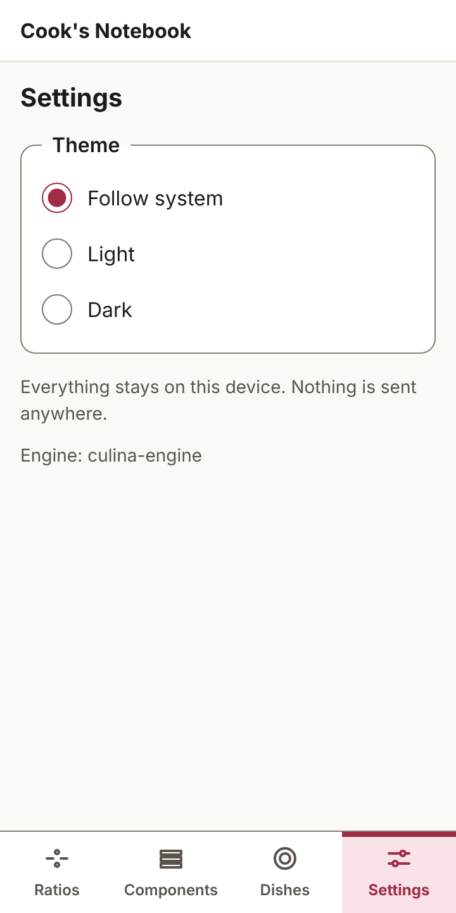                             |
| Ratios, 1000 x 700           | 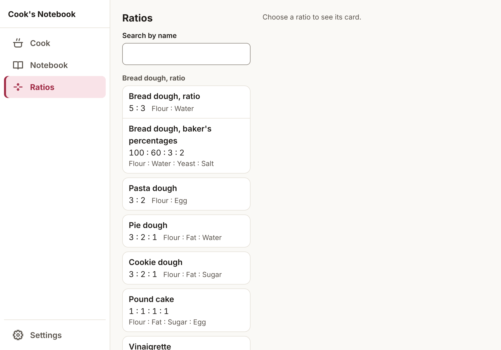                       |
| Ratio list, 360 x 720        |                          |
| Ratio card, 360 light        |                   |
| Ratio card, 360 dark         | 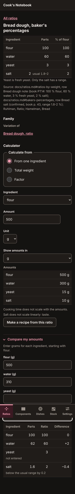                    |
| Ratio card, 1000 x 700       | 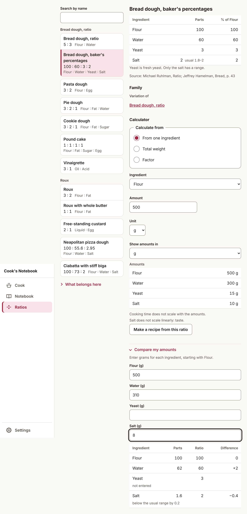               |
| Component, 360 x 720         |                            |
| Components list, 360 x 720   | 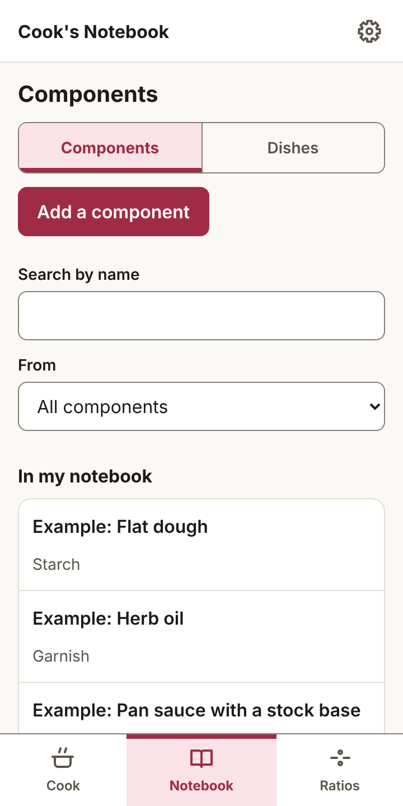               |
| Components list, 1000 x 700  | 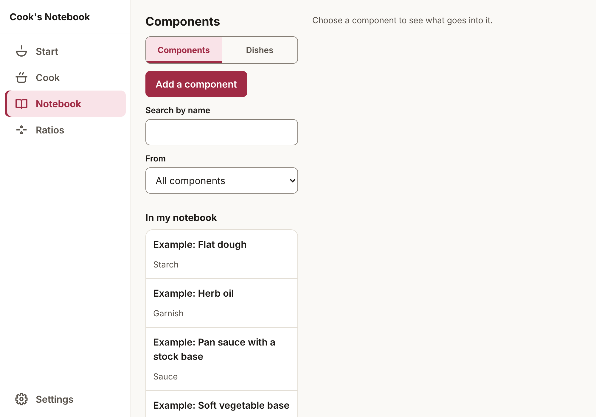     |
| Notebook dishes, 360 x 720   | 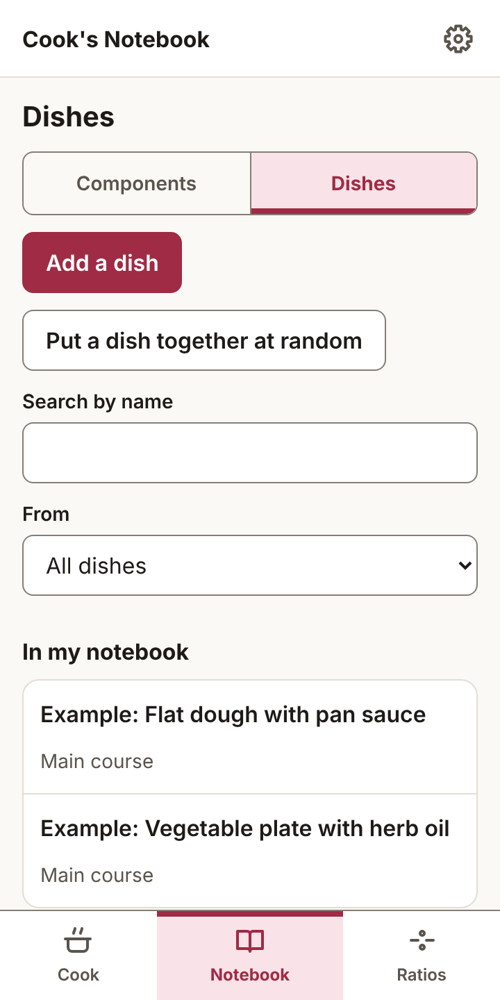                   |
| Notebook dishes, 1000 x 700  | 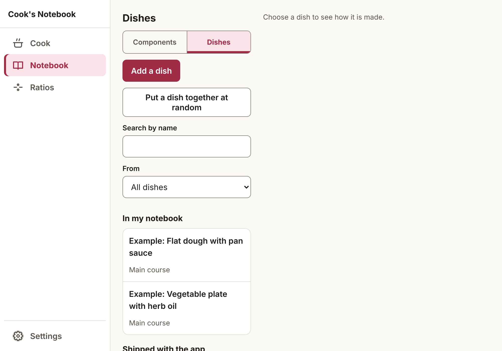         |
| Shipped component, 360       | 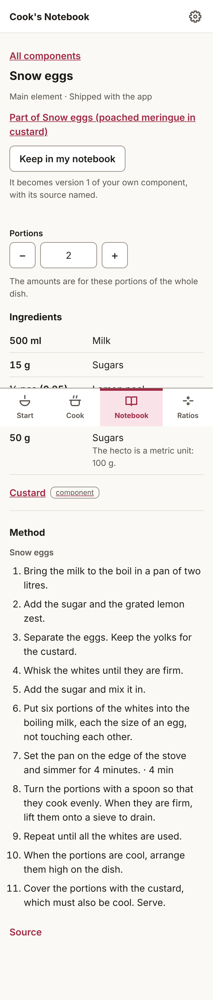           |
| Shipped component, 1000      | 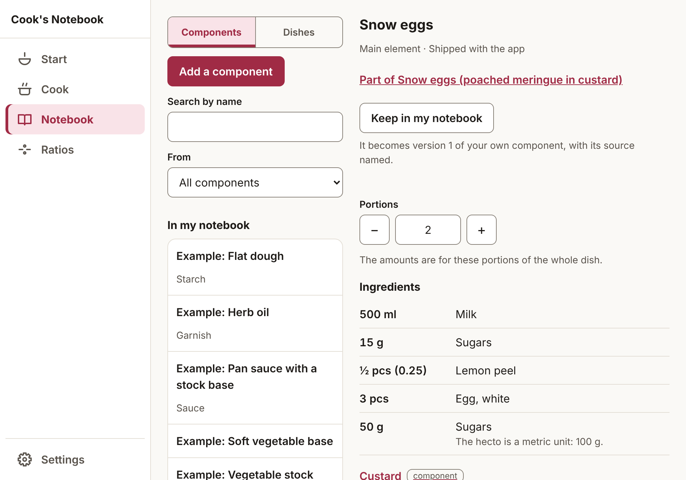 |
| Dish, 360 x 720 light        |                               |
| Dish, 360 x 720 dark         |                                 |
| Dish, 1000 x 700             |                            |
| Component editor, 360 light  | 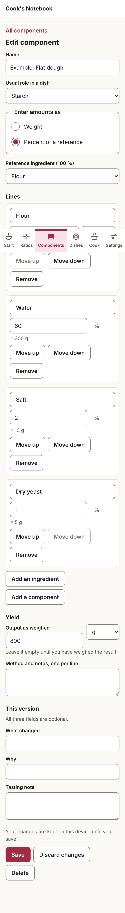      |
| Component editor, 360 dark   |         |
| Component editor, 1000 x 700 | 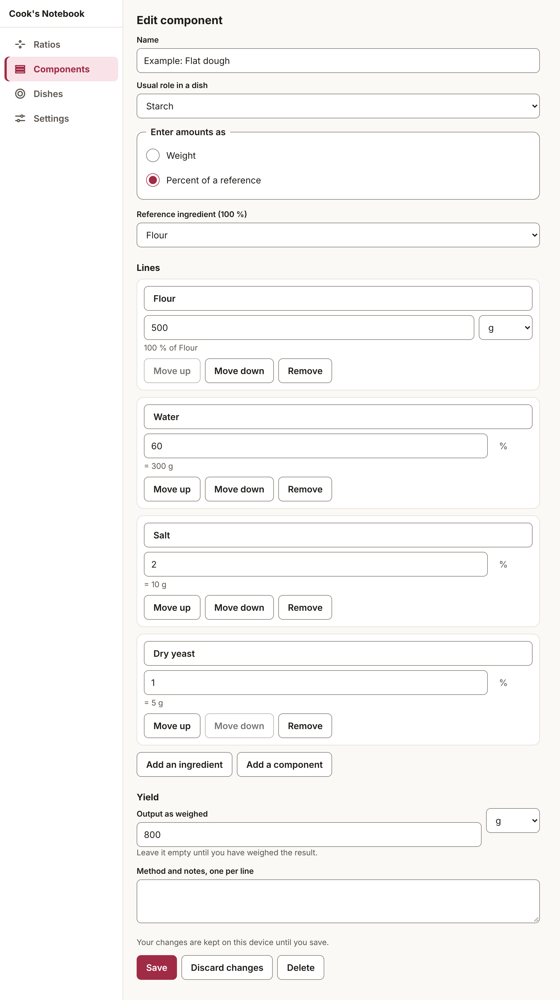   |
| Ingredient picker, 360 x 720 | 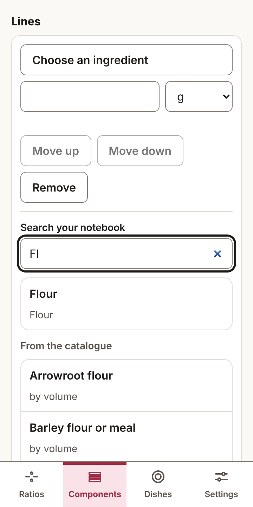                          |
| Dish editor, 360 x 720       |                        |
| Dish editor, 1000 x 700      | 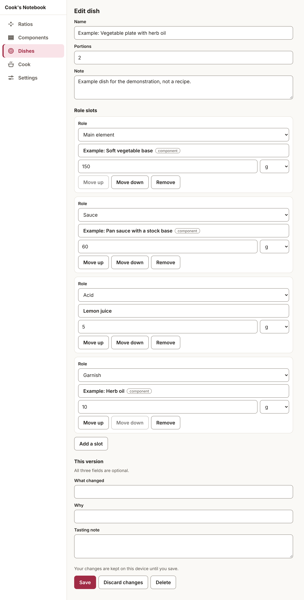             |
| History, 360 x 720 light     |                         |
| History, 360 x 720 dark      | 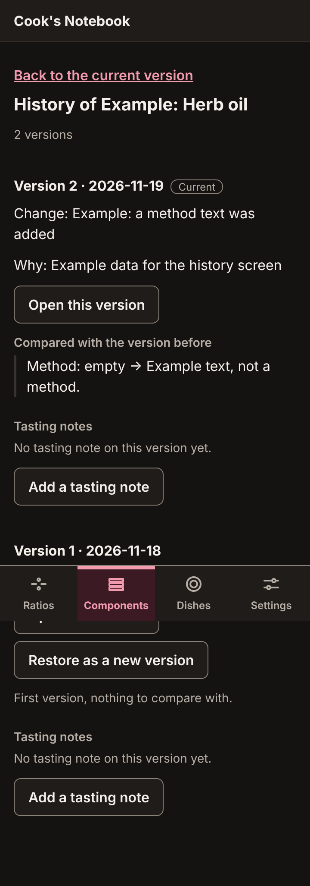                          |
| History, 1000 x 700          |                      |
| Older version, 360 x 720     | 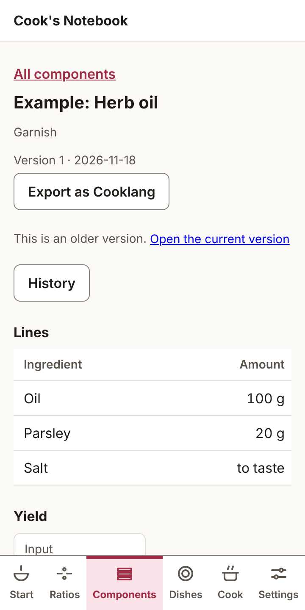                     |
| Older version, 1000 x 700    | 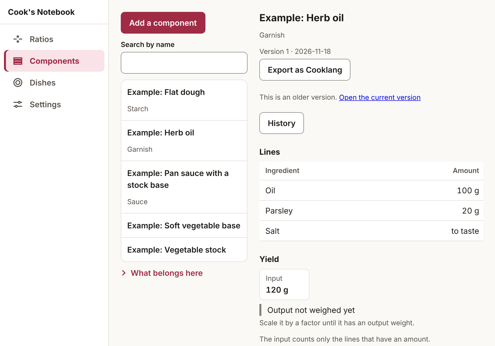           |

[^wcag]: W3C, WCAG 2.2, <https://www.w3.org/TR/WCAG22/>, read 2026-11-18.

[^mixtura]: Mixtura, `docs/design.md`, [apps/mixtura](../../mixtura), read 2026-11-18; no source code was read or copied.
